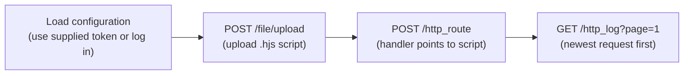

# xss-receiver

`xss-receiver-rs` is an XSS / information-receiver platform with programmable HTTP and
DNS servers. It captures, logs, and lets you customize responses to external requests
(useful for XSS data collection, SSRF/OOB probing, and DNS Log scenarios).

This skill is self-contained: it covers everything needed to use the platform without
reading its source code. It helps with two kinds of tasks:

1. **Write handler scripts** — use the built-in JavaScript engine to handle HTTP / DNS
   requests, customize responses, persist captured data, build a DNS Log, etc.
2. **Operate the platform** — use the admin HTTP API to upload script files, create and
   manage routes, and read received request logs.

## Platform capabilities

- **Programmable HTTP server**: routing rules (exact `PLAIN` / regex `REGEX`) map a
  request to a handler:
  - `STATIC`: return a stored file as-is.
  - `SCRIPT`: run a stored JavaScript file to build the response dynamically.
  - `NONE`: only log the request, return a default response (404).
- **Programmable DNS server**: same rule-based routing; answer statically or build
  `A` / `AAAA` / `CNAME` / `TXT` records from a script (good for DNS Log).
- **File storage**: a route's handler points to a file in storage; scripts can read/write
  storage via the `storage` object.
- **Script cache**: a lightweight shared key/value cache (`cache`) usable from both HTTP
  and DNS scripts.
- **Outbound HTTP client**: both script types can use top-level `await` with the shared
  server-side `http` object.
- **Storage ESM imports**: handlers can use static `import` or dynamic `import()` to load
  reusable JavaScript modules from storage.
- **Full request logging**: source address, headers, query, body, uploaded files, plus
  IP geolocation.
- **Admin API + web admin UI**: authenticated with login JWTs or dedicated API tokens; everything is callable under
  `<admin_prefix>/api/...`.

## File extension conventions

A handler points to one file in storage. These extensions are conventions (the admin
editor uses them for highlighting / type hints); the server reads the file the handler
config points to:

| Extension | Purpose                                      |
| --------- | -------------------------------------------- |
| `.hjs`    | HTTP `SCRIPT` handler or HTTP-focused module |
| `.djs`    | DNS `SCRIPT` handler or DNS-focused module   |
| `.djson`  | DNS `STATIC` answer (JSON)                   |

A `STATIC` HTTP handler can point to any file type and returns it verbatim.

## Connection configuration

Read `XSS_RECEIVER_CONFIG` from the environment before asking for connection details.
Its value is a JSON object:

```json
{
  "server_base": "https://example.com:8000",
  "admin_prefix": "/super_admin/",
  "token": "xrt_...",
  "dns_log_suffix": "dns.example.com"
}
```

- `server_base`: HTTP server origin, including scheme, host, and optional port.
- `admin_prefix`: the configured panel path, starting with `/`; it must not be `/`.
  Do not include `/api` or a frontend hash route.
- `token`: a dedicated token issued from the panel's authentication management page,
  or a login JWT. Send it as `Authorization: Bearer <token>`.
- `dns_log_suffix`: the domain suffix delegated to this instance's DNS server. For DNS
  Log tasks, use a unique label under this suffix, such as `<label>.dns.example.com`,
  when configuring a route, triggering a lookup, and finding the corresponding logs.

Build the API base URL by joining `server_base`, `admin_prefix`, and `/api` with one
slash between parts. HTTP callback URLs use `server_base` and the HTTP route path.
A configured token is sufficient: do not log in or ask for a password first.
Never print the configuration or token while inspecting the environment.

If the variable is absent or a required field is missing, use details already supplied
by the human and ask only for what the current task still needs. `dns_log_suffix` is
needed for DNS tasks, not ordinary HTTP operations. Report invalid JSON as a configuration
error before calling the API. Example values are placeholders; do not guess a deployment's
address, panel prefix, or DNS suffix. Username/password login remains available when the
human supplies credentials instead of a token; see [admin-api.md](admin-api.md).

## End-to-end workflow: add script -> add route -> read latest logs



1. **Authenticate**: load the configuration above and send the supplied token. If using
   username/password instead, `POST <prefix>/api/user/login` returns an `authorization` cookie.
2. **Upload a script**: `POST <prefix>/api/file/upload` (multipart; `path` = storage path
   such as `hooks/collect.hjs`, `file` = script content). Create any parent directory
   first with `POST <prefix>/api/file/mkdir`.
3. **Create a route**: `POST <prefix>/api/http_route` with `handler_kind=SCRIPT` and
   `handler` set to the uploaded path. Route changes take effect immediately; script
   source is loaded when the route handles a request.
4. **Read latest logs**: `GET <prefix>/api/http_log?page=1&page_size=20`; logs are ordered
   newest-first.
5. **Clean up temporary resources**: track the HTTP/DNS route IDs and file paths created
   for the task. Once the task is finished and no more callbacks are needed, delete those
   routes first, then their files if no longer used elsewhere, using the deletion endpoints
   in [admin-api.md](admin-api.md). Keep resources needed for long-running tasks or explicitly
   requested for continued use.

## Key things to remember

- **Use unguessable HTTP receiver paths.** Generate a fresh random `pattern` for each
  new HTTP receiving route, e.g. `/5cb4842a7587` (example only). Never use `/` or predictable
  paths such as `/collect`. Use the generated path in callback URLs as well.
- **Serving a static file? Use a `STATIC` handler, not a `SCRIPT`.** If you only need to
  return a stored file as-is (HTML page, JS payload, image, etc.), point a `STATIC` handler
  at that file — don't write a `SCRIPT` that just calls `response.sendFile`. Reach for
  `SCRIPT` only when the response must be built dynamically.
- **Auth**: the Authorization header takes precedence over the `authorization` cookie;
  an optional `Bearer ` prefix is accepted. Dedicated tokens inherit their owner's
  permissions except that they cannot create/delete users, change passwords, or issue
  new tokens; those operations require a password-login session. They default to no expiry
  and stop working when expired, revoked, or their owner is deleted. Tokens can also be
  restricted to a single client IP;
  requests from other IPs fail authentication. Login returns its JWT in `Set-Cookie`,
  not the response body.
- **Response envelope**: every endpoint returns HTTP 200 with body
  `{ "code": number, "msg": string|null, "payload": any }`. Success is `code == 200` —
  always check `code`, not the HTTP status.
- **Script `timeout` is in milliseconds** (route field); a timed-out script is aborted and
  an error is logged.
- **Script return value**: scripts are ES modules; `export default value` is serialized to
  JSON and stored in that request log's `extra_info` field. Top-level `await` is supported.
- **Module imports**: static `import` and dynamic `import()` load exact paths from user
  storage. Relative specifiers resolve from the importing file; other specifiers resolve
  from the storage root. Imported modules always inherit the entry route's HTTP or DNS
  globals, regardless of their extension.
- **Field name gotcha**: HTTP route delete/update use `http_route_id`; DNS route delete/update
  use `route_id`.

## Reference docs

- Script-engine API (`request` / `response` / `storage` / `cache` / `http` / helpers) and script
  examples: see [script-engine.md](script-engine.md)
- Admin API (auth / files / routes / logs) and an end-to-end curl example: see
  [admin-api.md](admin-api.md)
